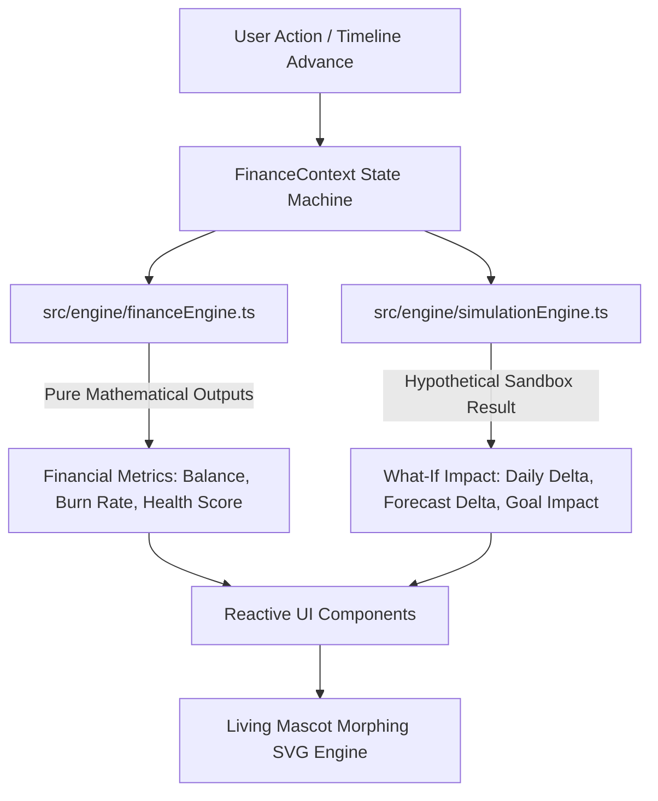

# 🏗️ Architecture & Technical Specification

> **Architectural Blueprint and Deterministic Engine Design for Broke But Functional.**

---

## 1. High-Level System Architecture

Broke But Functional is architected as an unidirectional, deterministic reactive financial engine with clear decoupling across 5 core tiers:

---

## 2. Layered Module Boundaries

| Layer | Path | Responsibility | Boundary Rule |
| :--- | :--- | :--- | :--- |
| **Domain Models & Types** | `src/types/finance.ts` | Type definitions, interfaces, schemas | Zero runtime dependencies |
| **Constants** | `src/constants/` | Domain limits (₹10k, 30 days, health tiers) | Immutable freeze objects |
| **Pure Logic Engines** | `src/engine/` | Mathematical formulas, financial calculations, sanitization | Pure functions, zero React dependencies |
| **Custom Hooks** | `src/hooks/` | Keyboard navigation, finance accessors | Reusable abstractions |
| **State Management** | `src/context/` | Centralized state provider, persistence, time-machine stepping | Single source of truth |
| **Presentation Tier** | `src/components/` | Accessible UI, SVG mascot morphing, charts, modals | Strict WCAG AA compliance |
| **Utilities** | `src/utils/` | Formatting, currency helpers | Pure helper functions |

---

## 3. Mathematical Engine Specifications

### 3.1 Dynamic Safe Daily Allowance
$$\text{Safe Daily Allowance} = \frac{\text{Liquid Balance} - \text{Committed Bills Ahead}}{\max(1, 30 - \text{Current Day} + 1)}$$

### 3.2 Financial Health Score ($0 \to 100$)
Composite weighted index measuring survival sustainability:
- **Runway Adequacy (40%)**: Ratio of remaining runway days to month horizon.
- **Burn Rate Compliance (30%)**: Current daily spending compared to initial ₹333/day budget.
- **Commitment Coverage (20%)**: Percentage of upcoming fixed obligations covered by liquid assets.
- **Discretionary Buffer (10%)**: Emergency resilience safety margin.

### 3.3 What-If Sandbox Delta
For any hypothetical purchase $(A, T)$:
$$\Delta \text{Balance} = \begin{cases} -A & \text{if } T = \text{expense} \\ +A & \text{if } T = \text{income} \end{cases}$$
$$\Delta \text{Daily Allowance} = \frac{\Delta \text{Balance}}{\max(1, 30 - \text{Current Day} + 1)}$$
$$\Delta \text{Monthly Forecast} = \Delta \text{Balance}$$

---

## 4. State Flow & Time Machine Progression

The simulation incorporates a discrete 30-day chronological state machine:
1. **Day Step Trigger**: Triggered via `advanceDay()` or hotkey `N`.
2. **Auto-Deductions**: Subscriptions and fixed bills whose `dueDay == currentDay` automatically post to the transaction ledger.
3. **Mascot Reactivity**: The living Mascot calculates its mood dynamically based on remaining runway and health score.

---

## 5. Security & Performance Blueprint

- **Input Sanitization**: Client-side transaction descriptions are sanitized via `DOMPurify` to nullify HTML injection, script tags, and `javascript:` vectors.
- **Defensive Numeric Guards**: Division by zero is eliminated via `Math.max(1, remainingDays)`.
- **Bundle Optimization**: Code-split via Vite Rollup manual chunks into sub-215 kB packages. Dialogs are lazy-loaded via `React.lazy` and `Suspense`.
- **Cache Strategy**: Immutable asset caching headers in `vercel.json` (`max-age=31536000, immutable`).
