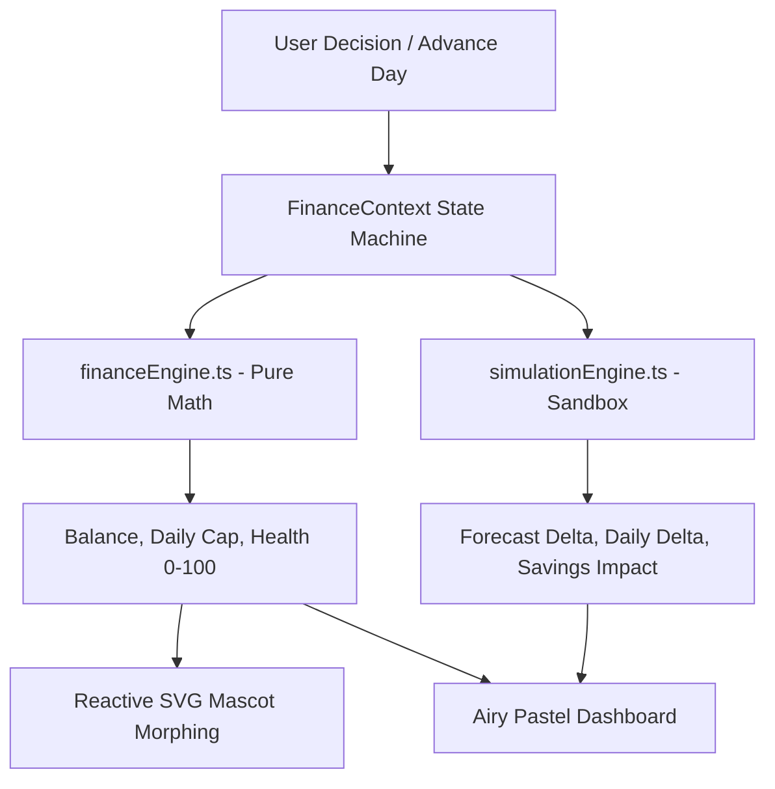

# 💸 Broke But Functional — Survive the Month
> **A Gen Z Interactive Personal Finance Experience engineered for the PROMPT RUN Hackathon.**

[](https://www.typescriptlang.org/)
[](https://vitest.dev/)
[](https://oxc-project.github.io/)
[](#)
[](./LICENSE)
[](https://broke-but-functional-beta.vercel.app/)

---

## 📑 Table of Contents

- [🌟 Overview & Problem Statement](#-overview--problem-statement)
- [🏗️ System Architecture](#️-system-architecture)
- [🎯 Mathematical Engine Specifications](#-mathematical-engine-specifications)
- [⚡ Key Features & Innovations](#-key-features--innovations)
- [⌨️ Keyboard Shortcuts](#️-keyboard-shortcuts)
- [🛡️ Security & Reliability](#️-security--reliability)
- [🧪 Testing & Verification](#-testing--verification)
- [🚀 Local Development](#-local-development)
- [📜 Project Links & License](#-project-links--license)

---

## 🌟 Overview & Problem Statement

**"Broke But Functional — Survive the Month"** is a consumer-facing personal finance simulation engineered specifically for young adults navigating a constrained budget of **₹10,000 across 30 days**.

Unlike passive expense trackers that record money after it is spent, this system acts as a **predictive financial flight simulator**, calculating real-time consequences for every rupee spent across six interconnected vectors:

1. **Liquid Cash Runway**: Starting with ₹10,000, continuously tracking days of runway left.
2. **Dynamic Safe Daily Allowance**: Automatically recalibrated every single day by subtracting upcoming locked commitments from remaining balance.
3. **Fixed Commitments & Recurring Bills**: Rent splits, Wi-Fi dues, pantry staples secured before discretionary spends.
4. **Active Subscriptions Management**: Spotify, Netflix, gym passes with instant pause/cancel toggles to free up runway.
5. **What-If Decision Simulator**: Sandbox test-driving purchase decisions before committing, displaying delta impact on daily allowance, monthly forecast, and savings goals.
6. **Living Mascot Expressions (Pocket Saathi)**: An in-place SVG squircle companion that morphs dynamically through 6 emotional states with humorous Hinglish thoughts and reality checks.

---

## 🏗️ System Architecture



### Module Organization
- `src/engine/`: Pure deterministic math and sanitization functions. Decoupled from React.
- `src/constants/`: Centralized domain limits (`₹10k`, `30 days`, health score thresholds).
- `src/hooks/`: Custom abstractions (`useFinance`, `useKeyboardShortcuts`).
- `src/context/`: Centralized finance state provider and 30-day time machine.
- `src/components/`: Modular accessible components with WCAG AA labels and ARIA regions.
- `src/utils/`: Number formatting and Indian currency notation helpers.

---

## 🎯 Mathematical Engine Specifications

### 1. Dynamic Safe Daily Allowance
$$\text{Safe Daily Allowance} = \frac{\text{Liquid Balance} - \text{Committed Bills Ahead}}{\max(1, 30 - \text{Current Day} + 1)}$$

### 2. Comprehensive Financial Health Score (0 - 100)
Weighted composite index evaluating survival resilience:
- **Runway Adequacy (40%)**: Ratio of remaining cash days to remaining month horizon.
- **Burn Rate Factor (30%)**: Spending pace compared to the ₹333/day baseline budget.
- **Commitment Coverage (20%)**: Protection ratio for upcoming mandatory bills.
- **Discretionary Cushion (10%)**: Safety reserve buffer.

### 3. What-If Sandbox Delta
For any hypothetical purchase $(A, T)$:
$$\Delta \text{Daily Allowance} = \frac{\Delta \text{Balance}}{\max(1, 30 - \text{Current Day} + 1)}$$
$$\Delta \text{Monthly Forecast} = \Delta \text{Balance}$$

---

## ⚡ Key Features & Innovations

- **In-Place Morphing Mascot**: Interactive SVG avatar morphing smoothly between *Thriving*, *Chill*, *Nervous*, *Panic*, *Dead*, and *Celebrating*.
- **30-Day Time Machine**: Step through the month day-by-day. Fixed commitments and subscriptions automatically deduct on their designated calendar due dates.
- **One-Click Scenario Switcher**: Instant testing across three presets:
  - *Fresh Start*: Day 1 with pristine ₹10,000 balance.
  - *Mid Squeeze*: Day 16 with ₹3,200 balance and upcoming rent bill.
  - *Survivor*: Day 24 with ₹850 balance and emergency medical shock.
- **Interactive Daily Spend Slider**: Instant slide-to-log spending slider with live mascot expressions.
- **Emergency Surprise Events**: Realistic shock cards (freelance gig inflow, medical prescription, laptop repair) with instantaneous recalibration.

---

## ⌨️ Keyboard Shortcuts

Power-user keyboard shortcuts for rapid, accessible navigation:

| Key | Action |
| :---: | :--- |
| <kbd>E</kbd> | Open Quick Expense Logger |
| <kbd>N</kbd> | Advance to Next Day (Step Forward) |
| <kbd>1</kbd> | Switch to **Simulator** tab |
| <kbd>2</kbd> | Switch to **Runway Forecast** tab |
| <kbd>3</kbd> | Switch to **Bills & Subscriptions** tab |
| <kbd>4</kbd> | Switch to **Safety Net Buffer** tab |
| <kbd>5</kbd> | Switch to **Daily Spend Ledger** tab |
| <kbd>Esc</kbd> | Dismiss any open modal overlay |

---

## 🛡️ Security & Reliability

- **Strict DOMPurify Sanitization**: All user-entered transaction titles, notes, and custom categories are sanitized against XSS, malicious tags, and javascript links.
- **Defensive Boundary Handling**: Complete protection against `NaN`, division-by-zero (`Math.max(1, daysRemaining)`), and negative values.
- **Production HTTP Security Headers** (via `vercel.json`):
  - `X-Content-Type-Options: nosniff`
  - `X-Frame-Options: DENY`
  - `X-XSS-Protection: 1; mode=block`
  - `Referrer-Policy: strict-origin-when-cross-origin`
  - Long-term immutable asset caching (`Cache-Control: public, max-age=31536000, immutable`).

---

## 🧪 Testing & Verification

Comprehensive test suite covering pure engines, context reducers, accessibility, and component rendering:

```bash
# Run full validation check (Types + Linter + 39 Tests)
npm run check
```

```text
Found 0 warnings and 0 errors across 40 files.
 Test Files  10 passed (10)
      Tests  39 passed (39)
   Duration  3.41s
```

---

## 🚀 Local Development

```bash
# Install dependencies
npm install

# Start development server
npm run dev

# Run Vitest test suite
npm test

# Build production bundle
npm run build
```

---

## 📜 Project Links & License

- **Live Deployment:** [broke-but-functional-beta.vercel.app](https://broke-but-functional-beta.vercel.app/)
- **Repository:** [github.com/anshuvdebnath-cyber/PROMPT-RUN-HACKATHON](https://github.com/anshuvdebnath-cyber/PROMPT-RUN-HACKATHON)
- **Architecture Documentation:** [ARCHITECTURE.md](./ARCHITECTURE.md)
- **Changelog:** [CHANGELOG.md](./CHANGELOG.md)
- **Security Policy:** [SECURITY.md](./SECURITY.md)
- **License:** [MIT License](./LICENSE)
